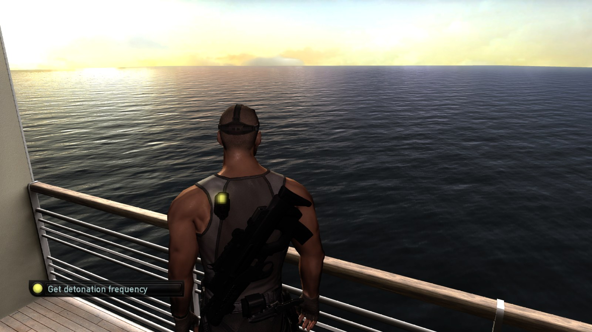
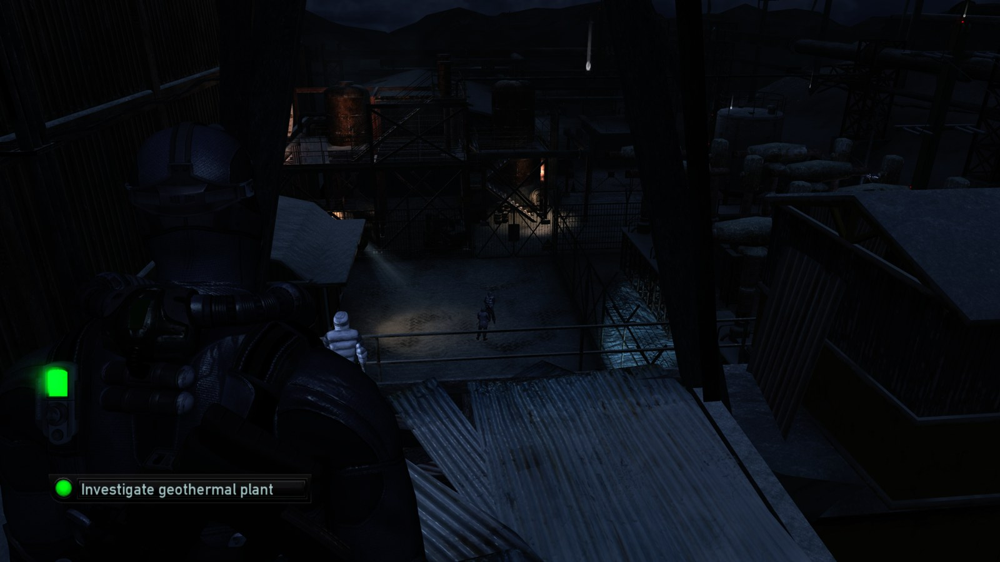
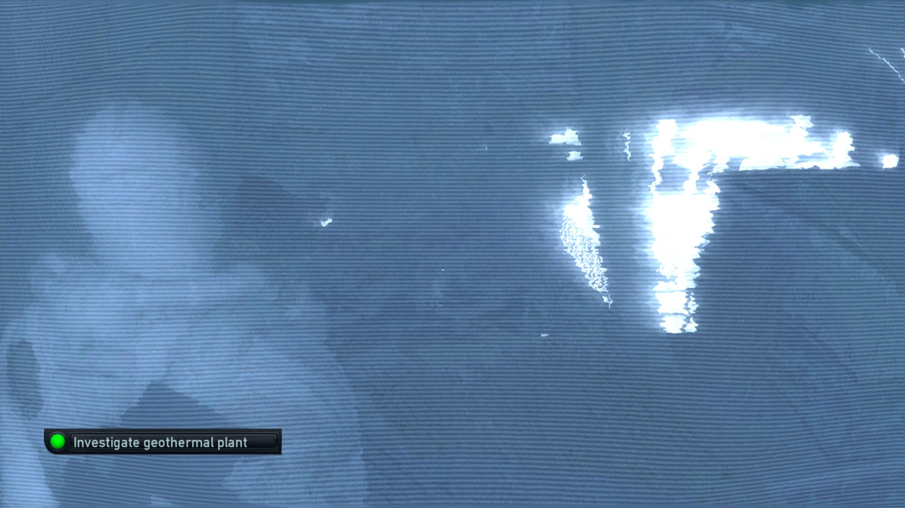
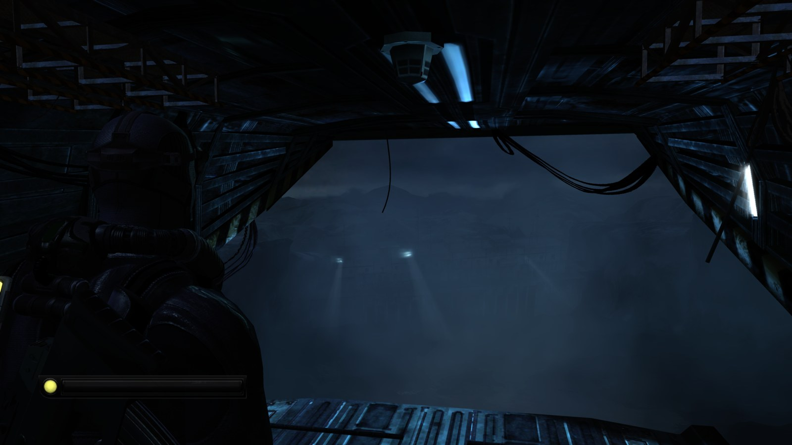
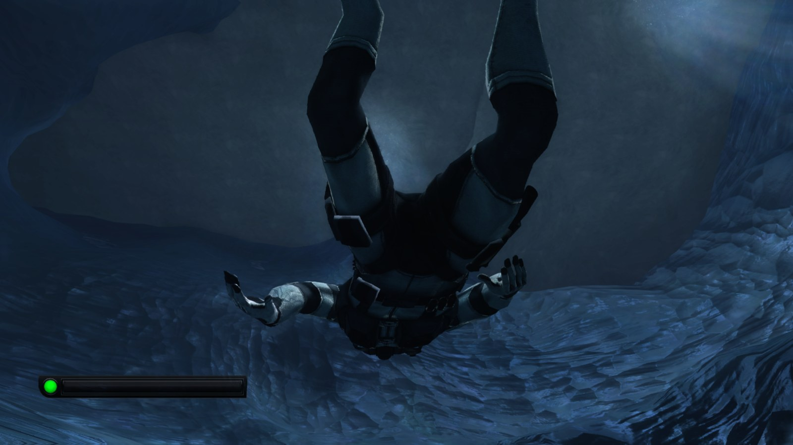
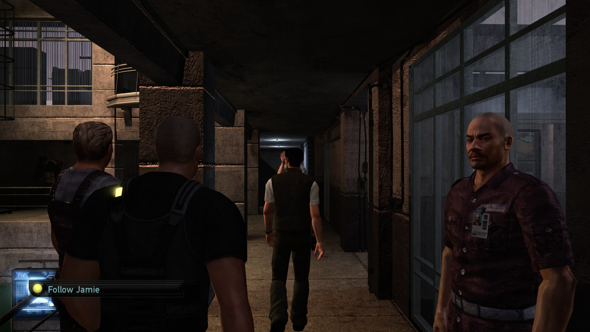

<div align="center">


# SCDA V1 Recomp

**Splinter Cell: Double Agent (Xbox 360) running natively on Windows. No emulator.**


</div>

> [!NOTE]
> **You can play the whole game.** Every mission loads, plays and saves, and missions lead into each other like on
> the console. What's left is polish: playing the story start to finish to catch the last visual bugs, and putting
> out a ready-made installer. Until then you have to build it yourself.

---

## What is this?

The Xbox 360 version of *Splinter Cell: Double Agent* is the better of the two versions, but it only runs on a 360 or
in an emulator. This project turns the game's Xbox 360 program into a real Windows program.

How, in plain terms:

- **The game code is translated ahead of time.** A tool reads the console's PowerPC code and rewrites all of it as
  C++, which is then compiled for your PC. Nothing is emulated while you play.
- **A small "fake console" fills in the rest.** The game still expects an Xbox 360 around it (its operating system,
  graphics chip and sound chip). This project provides those pieces on Windows:
  - **System calls** (files, threads, saves, your profile) go to Windows.
  - **Graphics** go to Direct3D 11. The game's own shaders are converted to PC shaders on the fly.
  - **Sound** (the Xbox 360's XMA format) is decoded with FFmpeg and played through XAudio2.

## What's new

**November 2026**

- **JBA headquarters looks right.** Big dark triangles no longer cover the walls and floors, and you can't see
  through the walls anymore. Some level geometry was being built from the wrong points.
- **The Iceland shack is solid.** Its roof and walls had holes from the inside. It was the same bug as the JBA HQ
  walls.
- **Hotel windows work.** Looking in through the rainy glass on the outside of the hotel, you now see the room and
  the people inside, not big blurry blocks. A small mistake in how the game's shaders were converted broke this effect.
- **Hotel mirrors are back.** The bathroom mirrors reflect Sam and the room again instead of showing a dark wall.
- **Hotel wardrobe stays the same.** Its red lattice doors no longer turn plain white until you walk up close.
- **No more flickering moon in New York.** The moon and clouds no longer pop out for a frame at a time.
- **No more black walls and floors** at the start of Kinshasa, on the Osprey ramp in Iceland and in the Cozumel
  room. A fix for New York's sky also darkened large surfaces close to the camera.
- **Clear sky through the ice.** Diving under the ice in Iceland and the Sea of Okhotsk, the view up through the
  water was smeared with Sam and other things from underwater. The water's view of the world above now leaves out everything below the surface, like the console.
- **Cozumel's sea reaches the horizon.** The black, jagged strip between the sea and the sky is gone.
- **Light distance setting** (F1 > Display). Lights switch off past a certain distance, so far parts of levels can
  look dark, for example the Iceland geothermal plant. The default x4 shows far more lights than the console, like
  the popular PC widescreen fix. x1 matches the console. It costs about 1.5 fps on the heaviest maps.
- **Reflections and water.** Shiny surfaces and water reflect again instead of showing black.
- **Shadows.** Kinshasa's ground is no longer covered in shadow, and the dark strip at the bottom of the screen in
  New York and the Hotel is gone.
- **No more black flashes** in the JBA headquarters.
- **EMF vision** looks like the console's.
- **Smaller fixes:** the strip at the bottom of the sniper scope, sparks and other particles, and a few texture and
  model formats. Every one of the game's 4,532 shaders now converts and compiles.
- **PlayStation and Switch controllers** work directly, with rumble. On-screen button icons match whatever you're
  holding, keyboard included, even on the loading screens.
- **Field of view slider** in the F1 menu (60-110, the game uses 75). L1/R1 switch tabs.
- **Installer** got a new look, a Start menu shortcut and an update mode that only swaps the game program. Your saves
  and settings are kept.

**Earlier**

- **Darkness matches the console.** The game sets up its own brightness curve at startup. That's now applied, so
  night scenes and dark rooms are as dark as on the Xbox 360.
- **Real anti-aliasing and no more glow streaks.** The console's 4x anti-aliasing is now done the way the 360 does
  it, which also removed yellow and orange streaks in Jail and Iceland.
- **Sea of Okhotsk fixed.** No more black screen underwater or white screen when looking up at the ice.
- **Sun shadows fixed** in Kinshasa: no more long dark wedges and smeared walls.
- **Things stop vanishing.** Objects no longer disappear every other frame when the PC is busy.
- **New York at full speed.** The heavy New York map got a big speed-up (see Known issues).
- **Clean goggles option.** Night, thermal and EMF vision without scanlines and noise.
- **Music loops without a gap**, and the last placeholder system calls now do real work.
- **Missions end properly.** Finishing a mission shows MISSION COMPLETE, saves your progress, plays the cutscene and
  starts the next mission, all without restarting the program.
- **Higher resolution.** `Scale=2` to `4` renders at 2560x1440 up to 5120x2880 and shrinks it to your window, which
  makes edges very smooth.
- **Sharper, steadier textures.** Distant surfaces no longer shimmer, and floors and walls stay sharp at an angle
  (anisotropic filtering up to 16x).
- **Brightness fixed at higher resolutions.** Scenes no longer turn twice as bright above `Scale=1`.
- **Checkpoints, restart and quit all work**, as many times as you like in one session.
- **Mouse works with a controller plugged in.** A slightly drifting stick no longer blocks the mouse and keyboard.

## Screenshots

Taken from the current build (November 2026) on Windows at `Scale=2` (2560x1440) with 16x anisotropic filtering.

| | |
|:-:|:-:|
|  |  |
| **Cozumel**: the sea reaches the horizon | **Iceland**: the geothermal plant, distant lights on (Light distance x4) |
|  |  |
| **Iceland**: EMF vision | **Iceland**: Osprey bay before the drop |
|  |  |
| **Ellsworth Penitentiary**: helping Jamie escape | **Sea of Okhotsk**: diving under the ice |
|  |  |
| **Kinshasa**: getting the plans, with sun shadows | **Shanghai**: arriving at the hotel |
|  | |
| **New York**: JBA headquarters | |

## How far along is it?

| Part | State |
|-|-|
| Menus and profile | ✅ Works |
| Missions | ✅ All 18 single-player maps load and play |
| During a mission | ✅ Checkpoints after failing, restart, quit to menu, load from the pause menu |
| Menu to mission, mission to mission | ✅ Works without restarting the program (mission to mission tested with a debug shortcut, not a full playthrough yet) |
| Saving and loading | ✅ Saves go to `%LOCALAPPDATA%\SCDARecomp`. Your position and difficulty come back |
| Graphics | 🟡 Almost everything matches the console. A few small differences are left (see below) |
| Sound | ✅ Music, 3D sound, dialogue and cutscene audio |
| Controls | ✅ Xbox, PlayStation and Switch controllers. 🟡 Mouse and keyboard work but need more testing |
| Multiplayer / Xbox Live | ❌ Not planned for now |

**Known issues**

- Most maps hold the game's 30 fps limit. New York's busiest areas can drop to about 25 fps.
- Fog, light shafts and the water surface seen from below may still look slightly different from the console in
  places.
- No ultrawide support yet.
- Above `Scale=1`, a post-processing effect can miss the very last row or column of pixels, and a faint line can
  show up about a third of the way down the screen.

## Coming next

Roughly in this order:

1. **Play the whole story by hand**, start to finish, and fix what turns up.
2. **A ready-made installer** for people who don't want to build it themselves. This will be the first release.
3. **Even closer to the console's look.** Fix the last small differences in fog and light shafts.
4. **Ultrawide and more PC options**, once the graphics are settled.

## How to play

> [!IMPORTANT]
> **No game files come with this project.** You need your own copy of *Splinter Cell: Double Agent* for Xbox 360.
> It's made for the **USA, Europe** disc (as an `.iso` file). Other versions won't work.

1. Build the program and the installer (`tools/installer/build.bat`). There's no download yet.
2. Run `SCDA_Setup.exe`, pick your disc image (`.iso`) and a folder to install to. It checks that your disc is the
   right one and copies the game files into `<folder>\game`.
3. Start `scda.exe` from that folder.

**Extra Settings menu.** Open it from the game's own **OPTIONS > EXTRA SETTINGS** (it replaces TV calibration;
brightness and contrast stay on the OPTIONS page), or any time with **F1** or **L3+R3**. It has three tabs:

- **Display:** window mode, VSync, resolution scale, texture sharpness (anisotropic filtering), field of view, light
  distance and clean goggles.
- **Graphics:** quality presets (Low to Ultra), extra smoothing (FXAA, on top of the game's own 4x anti-aliasing),
  sharpening, and upscaling (renders at a lower resolution and scales it up, for slower PCs).
- **Update:** your version and the newest version on GitHub. After you sign in at the main menu, a small message in
  the top right tells you if there's an update.

Changes apply right away and are saved. Close the menu with Esc, F1, Start or L3+R3.

Settings are stored in `%LOCALAPPDATA%\SCDARecomp\settings.ini`:

```ini
[Display]
Scale=2
Anisotropy=16
Mode=borderless
VSync=1
CleanGoggles=0
AntiAliasing=Off
Sharpening=0
Upscaling=Off
FOV=75
LightDistance=4
[Input]
MouseLook=1
MouseSensitivity=1.0
MouseInvertY=0
```

- `Scale` (1-4): the game renders at 1280x720 times this number, then shrinks it to your window. 2 = 2560x1440.
- `Anisotropy` (1-16): keeps floors and walls sharp when you look at them at an angle.
- `Mode`: `windowed`, `borderless` or `fullscreen`.
- `CleanGoggles=1`: no scanlines or noise in the goggle views.
- `FOV` (60-110): field of view. `LightDistance` (1-8): how far away lights stay on.
- Don't put comments on the same line as a setting.


## Building it yourself

You need: Windows 10 or 11 (64-bit), Visual Studio Build Tools 2022 (with CMake and Ninja), LLVM `clang-cl`,
Python 3 and Git.

```bat
:: 1. third-party sources go in external/ (XenonRecomp, XenosRecomp, UnleashedRecomp, ffmpeg)
tools\build_xenonrecomp.bat        :: applies tools\patches\xenonrecomp_scda.patch
tools\xex_dump\build.bat
tools\ffmpeg\configure.bat
:: 2. translate the game's code into generated/ (needs your own SC4_Offline.xex in assets/)
sh tools/recomp.sh
:: 3. build the program and run the tests
tools\build_runtime.bat
tools\test_runtime.bat
```

`STATE.md` has the detailed build notes, debug switches and current findings.

## What's in the repo

| Folder | What's inside |
|-|-|
| `runtime/` | The "fake console": system calls, threads, memory, graphics (including the shader converter) and sound |
| `config/` | Settings for the code translator (where functions and jump tables are) |
| `tools/` | Installer, game file tools, build and check scripts, tests |
| `docs/` | Notes, plans and screenshots |

## Credits

Built on [XenonRecomp](https://github.com/hedge-dev/XenonRecomp) and [XenosRecomp](https://github.com/hedge-dev/XenosRecomp),
with ideas from [UnleashedRecomp](https://github.com/hedge-dev/UnleashedRecomp), all by hedge-dev. A lot of what we
know about the Xbox 360 hardware comes from [Xenia](https://github.com/xenia-project/xenia). Sound decoding uses
[FFmpeg](https://ffmpeg.org). See [`THIRD_PARTY_NOTICES.md`](THIRD_PARTY_NOTICES.md). The source code is licensed under
**GPL-3.0** ([`LICENSE`](LICENSE)).

## Legal

This is an unofficial fan project. It isn't made, approved or supported by Ubisoft or Microsoft. *Splinter Cell*,
*Splinter Cell: Double Agent*, Sam Fisher and everything related belong to Ubisoft Entertainment. Xbox and Xbox 360
are trademarks of Microsoft.

- **No game files are included.** This repository only has original source code, build scripts and settings (like
  where functions are in the game's program). It contains no game program, graphics, sound, video or text.
- **You need to own the game.** The installer only works with your own Xbox 360 disc image of *Splinter Cell:
  Double Agent*. It checks the image and builds the game files on your own PC. Please don't ask for or share game
  files or disc images here. Those issues will be closed.
- **No piracy.** This project doesn't help anyone get the game. To read the game's code, the tools unpack the program
  from your own disc on your own PC, the same way other Xbox 360 recompilation projects do.
- **Screenshots** in `docs/images/` were taken with this project running the author's own copy of the game. They're
  only here to show progress.
- **Rights holders:** if you have a concern, please open an issue or contact the maintainer, and it will be handled
  quickly.
