<div align="center">

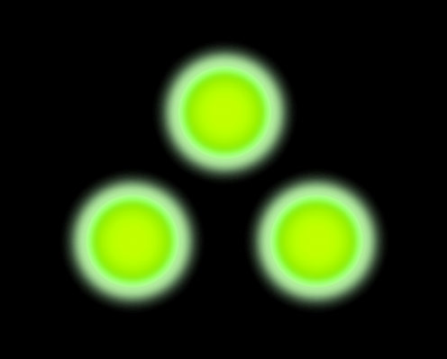

# SCDA V1 Recomp

**Splinter Cell: Double Agent (Xbox 360) running natively on Windows. No emulator.**

[](https://git.8gramlabs.com/8gramlabs/SCDA360pcport/releases/latest)
<a href="https://git.8gramlabs.com/8gramlabs/SCDA360pcport/releases/latest"></a>


[](https://git.8gramlabs.com/8gramlabs/SCDA360pcport/issues)
[](https://git.8gramlabs.com/8gramlabs/SCDA360pcport/issues/new?title=Idea:%20)


This project is free, and it stays free. I work on it in my free time. If you'd like to support that, you can leave a tip on Ko-fi. Donations are completely optional and don't unlock anything.

[](https://ko-fi.com/8gram_labs)

</div>

> [!NOTE]
> **Antivirus and "Windows protected your PC" warnings.** `SCDA_Setup.exe` is not code-signed (signing certificates cost money), so Windows SmartScreen and some antivirus programs may warn about it or flag it on heuristics. These are false positives: I can assure you nothing in it is malicious. If Windows says "Windows protected your PC", click **More info**, then **Run anyway**. All of the source code is right here in this repo, so if that would make you feel more comfortable, you're always welcome to [build it yourself](#building-it-yourself). Thanks for giving it a try!

> [!NOTE]
> **You can play the whole game.** Every mission loads, plays and saves, and missions lead into each other like on
> the console. The installer is out: get `SCDA_Setup.exe` from the
> [latest release](https://git.8gramlabs.com/8gramlabs/SCDA360pcport/releases/latest).

> [!WARNING]
> **This build still has visual bugs.** I fix as many as I can, but fixing one sometimes brings out a new one. The
> game is fully playable with them. If you see one, please [report it](#reporting-bugs) with screenshots or a video
> and your log file.

---

## What is this?

The Xbox 360 version of *Splinter Cell: Double Agent* is the better of the two versions, but it only runs on a 360 or
in an emulator. This project turns the game's Xbox 360 program into a real Windows program.

How, in plain terms:

- **The game code is translated ahead of time.** A tool reads the console's PowerPC code and rewrites all of it as
  C++, which is then compiled for your PC. Nothing is emulated while you play.
- **A small "fake console" fills in the rest.** The game still expects an Xbox 360 around it (its operating system,
  graphics chip and sound chip). This project provides those pieces on Windows:
  - **System calls** (files, threads, saves, your profile) go to Windows.
  - **Graphics** go to Direct3D 11. The game's own shaders are converted to PC shaders on the fly.
  - **Sound** (the Xbox 360's XMA format) is decoded with FFmpeg and played through XAudio2.

## What's new

**November 2026**

- **Achievements (#6).** Unlocks pop up with their name and picture and are saved on your PC. F1 > Achievements
  lists the 21 single-player ones.
- **Much lighter on your CPU (#4).** Three of the game's background loops kept a processor core busy at all
  times, even with nothing to do. They now sleep while they wait. In Ellsworth Prison the game uses about a third
  of the CPU it used before, at the same 30 fps, and some levels load faster.
- **In-game updates (#7).** F1 > Update can download and install a new version for you and restart the game, or
  do it automatically at startup.
- **Brightness and gamma (#21), FPS overlay (#23) and monitor choice (#12)** in F1 > Display.
- **Rebind the keyboard and mouse (#1)** in `settings.ini` (`[Keys]`), plus a **walk key** (Shift) for slow,
  quiet movement on the keyboard.
- **Controller options (#13):** turn the controller off, or change how fast it turns the camera.
- **JBA headquarters looks right.** Big dark triangles no longer cover the walls and floors, and you can't see
  through the walls anymore. Some level geometry was being built from the wrong points.
- **The Iceland shack is solid.** Its roof and walls had holes from the inside. It was the same bug as the JBA HQ
  walls.
- **Character shadows at JBA HQ.** Sam, the other characters and the furniture cast shadows from the HQ room
  lights again, like on the Xbox 360.
- **Hotel windows work.** Looking in through the rainy glass on the outside of the hotel, you now see the room and
  the people inside, not big blurry blocks. A small mistake in how the game's shaders were converted broke this effect.
- **Hotel mirrors are back.** The bathroom mirrors reflect Sam and the room again instead of showing a dark wall.
- **Hotel wardrobe stays the same.** Its red lattice doors no longer turn plain white until you walk up close.
- **No more flickering moon in New York.** The moon and clouds no longer pop out for a frame at a time.
- **No more black walls and floors** at the start of Kinshasa, on the Osprey ramp in Iceland and in the Cozumel
  room. A fix for New York's sky also darkened large surfaces close to the camera.
- **Cozumel's sea reaches the horizon.** The black, jagged strip between the sea and the sky is gone.
- **Reflections and water.** Shiny surfaces and water reflect again instead of showing black.
- **Shadows.** Kinshasa's ground is no longer covered in shadow, and the dark strip at the bottom of the screen in
  New York and the Hotel is gone.
- **No more black flashes** in the JBA headquarters, including the floor and walls blinking out while you turn
  the camera.
- **EMF vision** looks like the console's.
- **Smaller fixes:** the strip at the bottom of the sniper scope, sparks and other particles, and a few texture and
  model formats. Every one of the game's 4,532 shaders now converts and compiles.
- **PlayStation and Switch controllers** work directly, with rumble. On-screen button icons match whatever you're
  holding, keyboard included, even on the loading screens.
- **Field of view slider** in the F1 menu (60-110, the game uses 75). L1/R1 switch tabs.
- **Installer** got a new look, a Start menu shortcut and an update mode that only swaps the game program. Your saves
  and settings are kept.

**Earlier**

- **Darkness matches the console.** The game sets up its own brightness curve at startup. That's now applied, so
  night scenes and dark rooms are as dark as on the Xbox 360.
- **Real anti-aliasing and no more glow streaks.** The console's 4x anti-aliasing is now done the way the 360 does
  it, which also removed yellow and orange streaks in Jail and Iceland.
- **Sea of Okhotsk fixed.** No more black screen underwater or white screen when looking up at the ice.
- **Sun shadows fixed** in Kinshasa: no more long dark wedges and smeared walls.
- **Things stop vanishing.** Objects no longer disappear every other frame when the PC is busy.
- **New York at full speed.** The heavy New York map got a big speed-up (see Known issues).
- **Clean goggles option.** Night, thermal and EMF vision without scanlines and noise.
- **Music loops without a gap**, and the last placeholder system calls now do real work.
- **Missions end properly.** Finishing a mission shows MISSION COMPLETE, saves your progress, plays the cutscene and
  starts the next mission, all without restarting the program.
- **Higher resolution.** `Scale=2` to `4` renders at 2560x1440 up to 5120x2880 and shrinks it to your window, which
  makes edges very smooth.
- **Sharper, steadier textures.** Distant surfaces no longer shimmer, and floors and walls stay sharp at an angle
  (anisotropic filtering up to 16x).
- **Brightness fixed at higher resolutions.** Scenes no longer turn twice as bright above `Scale=1`.
- **Checkpoints, restart and quit all work**, as many times as you like in one session.
- **Mouse works with a controller plugged in.** A slightly drifting stick no longer blocks the mouse and keyboard.

## Screenshots

Taken from the current build (November 2026) on Windows at `Scale=2` (2560x1440) with 16x anisotropic filtering.

| | |
|:-:|:-:|
|  |  |
| **Cozumel**: the sea reaches the horizon | **Iceland**: the geothermal plant at night |
|  |  |
| **Iceland**: EMF vision | **Iceland**: Osprey bay before the drop |
| 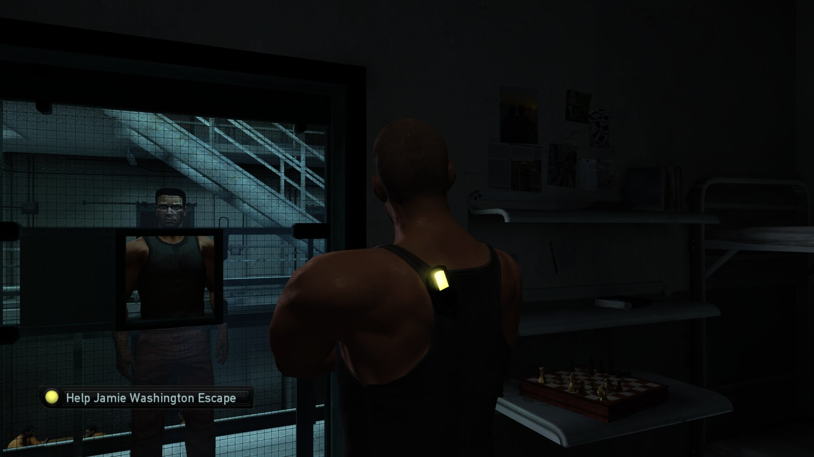 |  |
| **Ellsworth Penitentiary**: helping Jamie escape | **Sea of Okhotsk**: diving under the ice |
| 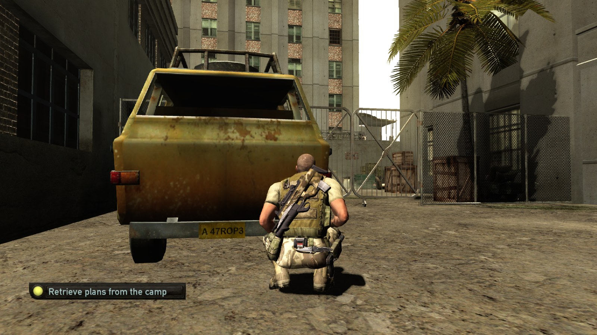 | 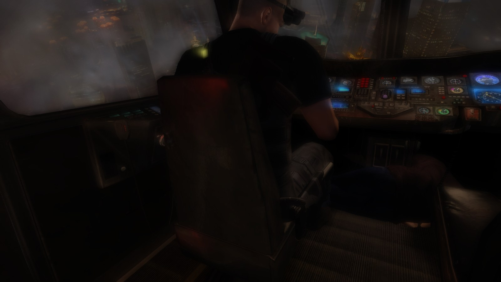 |
| **Kinshasa**: getting the plans, with sun shadows | **Shanghai**: arriving at the hotel |
|  | 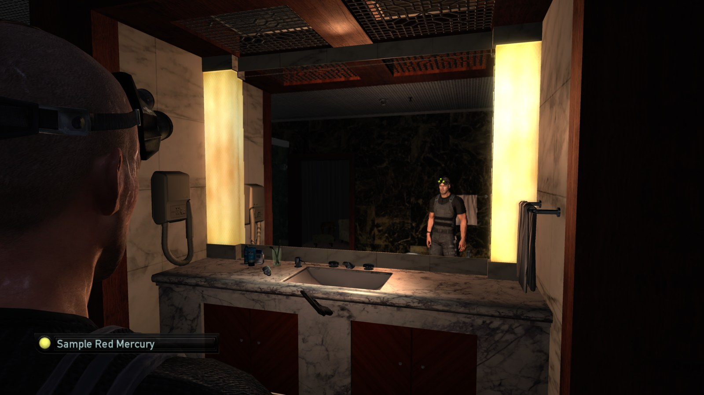 |
| **New York**: JBA headquarters | **Shanghai**: the bathroom mirror reflects Sam again |
| 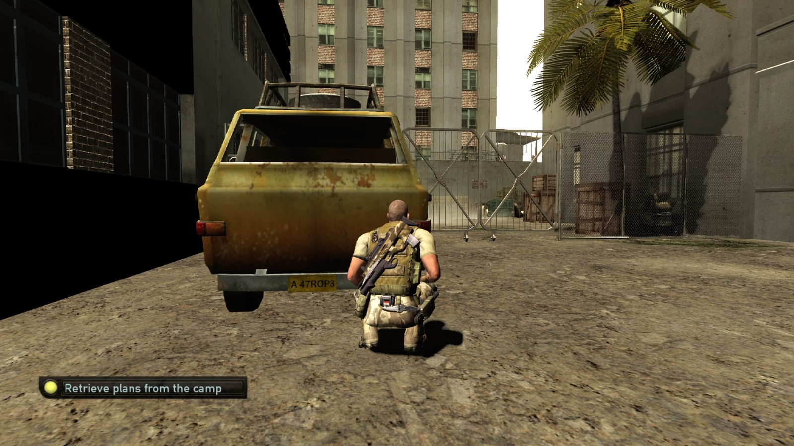 | 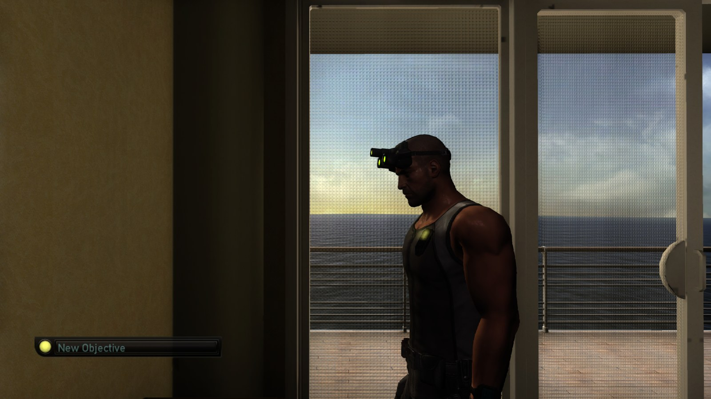 |
| **Kinshasa**: the alley at the start, walls no longer black | **Cozumel**: the cabin and its balcony |
| 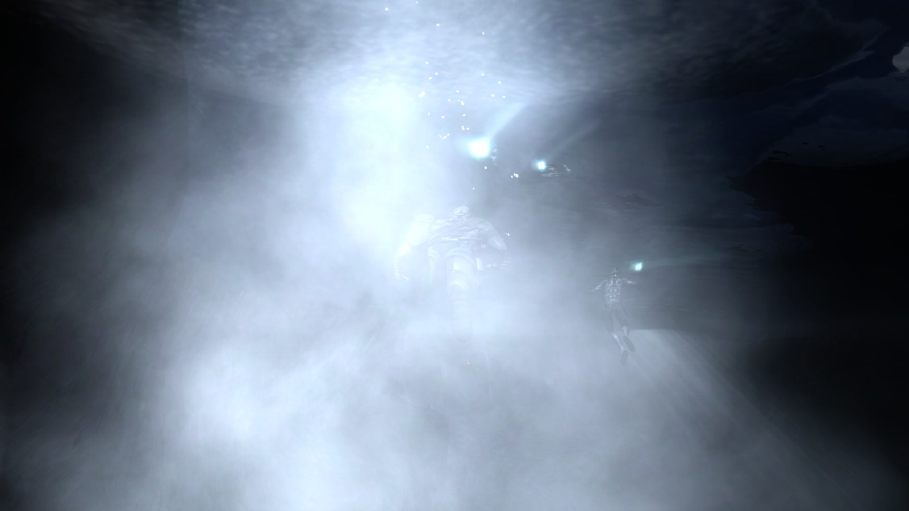 | 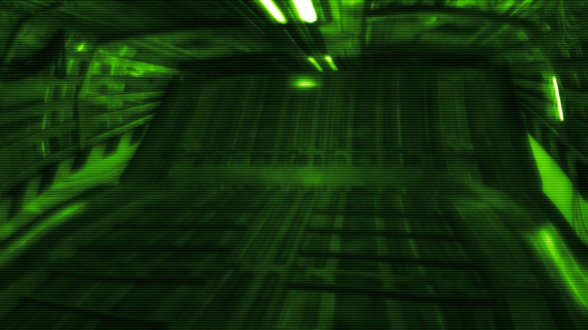 |
| **Iceland**: the light shaft through the ice hole | **Iceland**: the Osprey ramp in night vision |
| 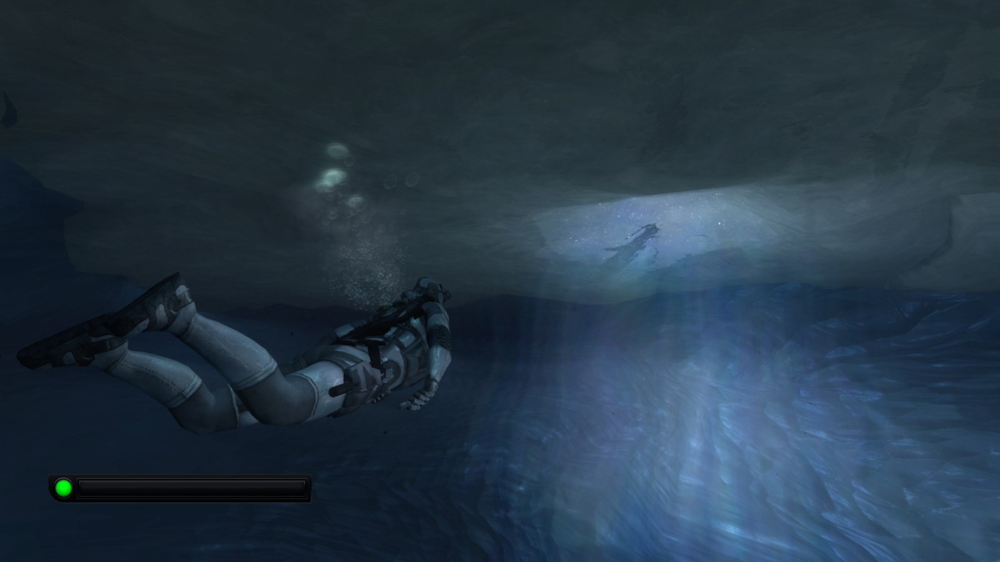 | |
| **Sea of Okhotsk**: swimming under the ice | |

## How far along is it?

| Part | State |
|-|-|
| Menus and profile | ✅ Works |
| Missions | ✅ All 18 single-player maps load and play |
| During a mission | ✅ Checkpoints after failing, restart, quit to menu, load from the pause menu |
| Menu to mission, mission to mission | ✅ Works without restarting the program (mission to mission tested with a debug shortcut, not a full playthrough yet) |
| Saving and loading | ✅ Saves go to `%LOCALAPPDATA%\SCDARecomp`. Your position and difficulty come back |
| Graphics | 🟡 Almost everything matches the console. A few small differences are left (see below) |
| Sound | ✅ Music, 3D sound, dialogue and cutscene audio |
| Controls | ✅ Xbox, PlayStation and Switch controllers. 🟡 Mouse and keyboard work but need more testing |
| Multiplayer / Xbox Live | ❌ Not planned for now |

**Known issues**

- All levels tested hold the game's 30 fps limit, including New York's busiest areas (Scale 3, RTX 4080 SUPER).
- No ultrawide support yet. 21:9 and 32:9 are planned.
- Above `Scale=1`, a post-processing effect can miss the very last row or column of pixels, and a faint line can
  show up about a third of the way down the screen.

## Reporting bugs

Open an [issue](https://git.8gramlabs.com/8gramlabs/SCDA360pcport/issues) and include:

- **Screenshots or a short video** of the bug.
- **Where it happened**: the mission and the area.
- **Your log file**: `scda.log` in your install folder, next to `scda.exe`. It's replaced every time you start the
  game, so copy it right after the bug happens.
- Your `%LOCALAPPDATA%\SCDARecomp\settings.ini`, if you changed any settings.

## Ideas

Have an idea or a feature you'd like to see? Open an [issue](https://git.8gramlabs.com/8gramlabs/SCDA360pcport/issues/new) starting the title with "Idea:".
Bugs go in [Issues](https://git.8gramlabs.com/8gramlabs/SCDA360pcport/issues) too (see above).

## Coming next

Roughly in this order:

1. **Play the whole story by hand**, start to finish, and fix what turns up.
2. **Ultrawide and more PC options**, once the graphics are settled.

## How to play

> [!IMPORTANT]
> **No game files come with this project.** You need your own copy of *Splinter Cell: Double Agent* for Xbox 360.
> It's made for the **USA, Europe** disc (as an `.iso` file). Other versions won't work.

1. Download `SCDA_Setup.exe` from the [latest release](https://git.8gramlabs.com/8gramlabs/SCDA360pcport/releases/latest)
   (or build it yourself, see below).
   The installer isn't code-signed, so Windows or your antivirus may warn about it. If Windows says "Windows
   protected your PC", click **More info**, then **Run anyway**.
2. Run `SCDA_Setup.exe`, pick your disc image (`.iso`) and a folder to install to. It checks that your disc is the
   right one and copies the game files into `<folder>\game`.
3. Start `scda.exe` from that folder.

**Extra Settings menu.** Open it from the game's own **OPTIONS > EXTRA SETTINGS** (it replaces TV calibration;
brightness and contrast stay on the OPTIONS page), or any time with **F1** or **L3+R3**. It has three tabs:

- **Display:** window mode, monitor, brightness, gamma, performance overlay, VSync, resolution scale, texture
  sharpness (anisotropic filtering), field of view, language and clean goggles.
- **Graphics:** quality presets (Low to Ultra), extra smoothing (FXAA, on top of the game's own 4x anti-aliasing),
  sharpening, and upscaling (renders at a lower resolution and scales it up, for slower PCs).
- **Update:** your version and the newest released version, a button that installs the update and restarts the
  game, and an option to do that automatically at startup. After you sign in at the main menu, a small message in
  the top right tells you if there's an update.

Changes apply right away and are saved. Close the menu with Esc, F1, Start or L3+R3.

Settings are stored in `%LOCALAPPDATA%\SCDARecomp\settings.ini`:

```ini
[Display]
Scale=2
Anisotropy=16
Mode=borderless
VSync=1
CleanGoggles=0
AntiAliasing=Off
Sharpening=0
Upscaling=Off
FOV=75
Brightness=1.0
Gamma=1.0
PerformanceOverlay=Off
Monitor=0
[Input]
MouseLook=1
MouseSensitivity=1.0
MouseInvertY=0
Gamepad=1
GamepadSensitivity=1.0
WalkSpeed=0.5
WheelMoveSpeed=1
ButtonPrompts=Auto
[Keys]
A=Enter,Space
Walk=Shift
[Update]
CheckOnStart=1
AutoInstall=0
```

- `Scale` (1-4): the game renders at 1280x720 times this number, then shrinks it to your window. 2 = 2560x1440.
- `Anisotropy` (1-16): keeps floors and walls sharp when you look at them at an angle.
- `Mode`: `windowed`, `borderless` or `fullscreen`.
- `CleanGoggles=1`: no scanlines or noise in the goggle views.
- `FOV` (60-110): field of view.
- `Brightness`, `Gamma` (0.5-2.0, 1.0 = as on the console): `Gamma` above 1 makes dark areas easier to see.
- `PerformanceOverlay`: `Off`, `FPS` or `Detailed` (frame time, CPU use, resolution).
- `Monitor`: 0 = main display, 1, 2, ... = the others. Applies at the next start.
- `Gamepad=0` ignores controllers. `GamepadSensitivity` (0.25-3) scales the controller's camera stick.
- `ButtonPrompts`: `Auto`, `Xbox`, `PlayStation` or `Keyboard` button icons.
- `[Keys]`: `Action=Key` or `Action=Key1,Key2` (`None` unbinds). Actions: `A B X Y Start Back Up Down Left Right
  LB RB LS RS LT RT MoveForward MoveBack MoveLeft MoveRight LookUp LookDown LookLeft LookRight Walk`. Keys: letters,
  digits, `F2`-`F12`, `Space Enter Escape Tab Backspace Shift Ctrl Alt CapsLock Up Down Left Right Insert Delete
  Home End PageUp PageDown Numpad0`-`Numpad9 Mouse1`-`Mouse5`. On-screen key icons still show the default keys.
- `WalkSpeed` (0.1-1): how far the movement keys push the stick while `Walk` is held.
- `WheelMoveSpeed=1`: in game, the mouse wheel sets how fast the movement keys move Sam (4 steps, wheel up =
  faster), like the PC version. `0` = the wheel is d-pad up/down instead. In menus the wheel always scrolls.
- Don't put comments on the same line as a setting.

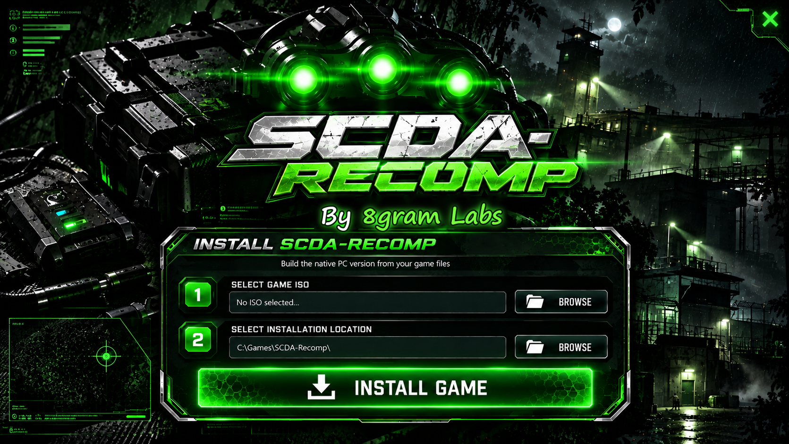

## Building it yourself

You need: Windows 10 or 11 (64-bit), Visual Studio Build Tools 2022 (with CMake and Ninja), LLVM `clang-cl`,
Python 3 and Git.

```bat
:: 1. third-party sources go in external/ (XenonRecomp, XenosRecomp, UnleashedRecomp, ffmpeg)
tools\build_xenonrecomp.bat        :: applies tools\patches\xenonrecomp_scda.patch
tools\xex_dump\build.bat
tools\ffmpeg\configure.bat
:: 2. translate the game's code into generated/ (needs your own SC4_Offline.xex in assets/)
sh tools/recomp.sh
:: 3. build the program and run the tests
tools\build_runtime.bat
tools\test_runtime.bat
```

`STATE.md` has the detailed build notes, debug switches and current findings.

## What's in the repo

| Folder | What's inside |
|-|-|
| `runtime/` | The "fake console": system calls, threads, memory, graphics (including the shader converter) and sound |
| `config/` | Settings for the code translator (where functions and jump tables are) |
| `tools/` | Installer, game file tools, build and check scripts, tests |
| `docs/` | Notes, plans and screenshots |

## Credits

Built on XenonRecomp and XenosRecomp,
with ideas from UnleashedRecomp, all by hedge-dev. A lot of what we
know about the Xbox 360 hardware comes from the Xenia emulator project. Sound decoding uses
[FFmpeg](https://ffmpeg.org). See [`THIRD_PARTY_NOTICES.md`](THIRD_PARTY_NOTICES.md). The source code is licensed under
**GPL-3.0** ([`LICENSE`](LICENSE)).

## Legal

This is an unofficial fan project. It isn't made, approved or supported by Ubisoft or Microsoft. *Splinter Cell*,
*Splinter Cell: Double Agent*, Sam Fisher and everything related belong to Ubisoft Entertainment. Xbox and Xbox 360
are trademarks of Microsoft.

- **No game files are included.** This repository only has original source code, build scripts and settings (like
  where functions are in the game's program). It contains no game program, graphics, sound, video or text.
- **You need to own the game.** The installer only works with your own Xbox 360 disc image of *Splinter Cell:
  Double Agent*. It checks the image and builds the game files on your own PC. Please don't ask for or share game
  files or disc images here. Those issues will be closed.
- **No piracy.** This project doesn't help anyone get the game. To read the game's code, the tools unpack the program
  from your own disc on your own PC, the same way other Xbox 360 recompilation projects do.
- **Screenshots** in `docs/images/` were taken with this project running the author's own copy of the game. They're
  only here to show progress.
- **Rights holders:** if you have a concern, please open an issue or contact the maintainer, and it will be handled
  quickly.
